# INEC Election Results Agent - Design Document

## Overview

This document provides the comprehensive technical design for the INEC Election Results Agent - an AI-powered system that automates the extraction, processing, and aggregation of Nigerian election results from the INEC IREV (INEC Result Viewing) portal.

### System Goals

1. Navigate the INEC portal hierarchy (Election Type → State → LGA → Ward → Polling Unit)
2. Download result sheet images (PDF/PNG) from polling units
3. Extract vote data using OCR and AI-based document understanding
4. Store structured data in a relational database
5. Aggregate votes by political party at Ward and LGA levels
6. Export results in CSV/JSON formats

### Key Design Decisions

| Decision | Choice | Rationale |
|----------|--------|-----------|
| Web Scraping | Playwright | Handles dynamic JavaScript content, headless browser support |
| OCR Engine | GPT-4 Vision + Tesseract fallback | High accuracy for handwritten/scanned documents |
| Backend Framework | FastAPI (Python) | Async support, automatic OpenAPI docs, type hints |
| Frontend Framework | Next.js + React | SSR, API routes, modern React patterns |
| Database | PostgreSQL | Relational integrity, JSON support, full-text search |
| Task Queue | Celery + Redis | Distributed task processing, retry mechanisms |
| Agent Orchestration | LangGraph | Multi-agent coordination, state management |

---

## Architecture

### High-Level System Architecture

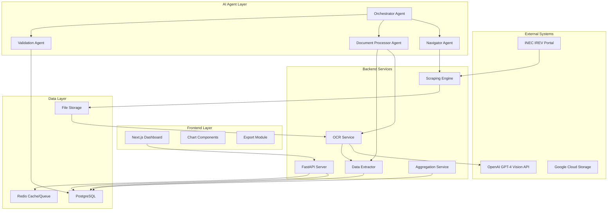


### Data Flow Architecture

```mermaid
flowchart LR
    subgraph Ingestion["Data Ingestion"]
        A1["Portal Navigation"] --> A2["Page Discovery"]
        A2 --> A3["Image Download"]
        A3 --> A4["File Storage"]
    end

    subgraph Processing["Data Processing"]
        B1["Image Preprocessing"] --> B2["OCR Extraction"]
        B2 --> B3["AI Data Parsing"]
        B3 --> B4["Validation"]
    end

    subgraph Storage["Data Storage"]
        C1["Raw Results"] --> C2["Aggregated Results"]
        C2 --> C3["Export Generation"]
    end

    A4 --> B1
    B4 --> C1
```

---

## Components and Interfaces

### 1. UI Technical Documentation

#### 1.1 Frontend Architecture

The dashboard is built with Next.js 14 using the App Router pattern with React Server Components.

```
frontend/
├── app/
│   ├── layout.tsx              # Root layout with providers
│   ├── page.tsx                # Home/Dashboard page
│   ├── elections/
│   │   ├── page.tsx            # Election types list
│   │   └── [type]/
│   │       ├── page.tsx        # States list
│   │       └── [state]/
│   │           └── page.tsx    # LGA/Ward/PU drill-down
│   ├── results/
│   │   ├── page.tsx            # Results overview
│   │   └── [id]/page.tsx       # Individual result detail
│   ├── aggregation/
│   │   └── page.tsx            # Aggregation views
│   └── api/                    # API route handlers
├── components/
│   ├── ui/                     # Shadcn/ui components
│   ├── charts/                 # Chart components
│   ├── tables/                 # Data table components
│   └── forms/                  # Form components
├── lib/
│   ├── api.ts                  # API client
│   └── utils.ts                # Utility functions
└── types/
    └── index.ts                # TypeScript interfaces
```


#### 1.2 Key UI Components

```typescript
// types/index.ts
interface ElectionResult {
  id: string;
  electionType: ElectionType;
  state: string;
  lga: string;
  ward: string;
  pollingUnit: string;
  partyResults: PartyResult[];
  accreditedVoters: number;
  validVotes: number;
  rejectedVotes: number;
  extractedAt: Date;
  confidenceScore: number;
  sourceImagePath: string;
}

interface PartyResult {
  partyName: string;
  partyCode: string;
  voteCount: number;
  percentage: number;
}

interface AggregatedResult {
  level: 'ward' | 'lga' | 'state';
  locationId: string;
  locationName: string;
  partyResults: PartyResult[];
  totalPollingUnits: number;
  processedPollingUnits: number;
  flaggedPollingUnits: number;
}

type ElectionType = 
  | 'presidential'
  | 'governorship'
  | 'senatorial'
  | 'house_of_reps'
  | 'house_of_assembly'
  | 'chairmanship'
  | 'councilor';
```

#### 1.3 Dashboard Views

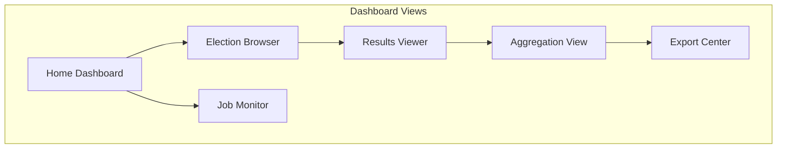


#### 1.4 Chart Components

| Component | Library | Purpose |
|-----------|---------|---------|
| `PartyBarChart` | Recharts | Horizontal bar chart for party vote comparison |
| `VoteDistributionPie` | Recharts | Pie chart for vote distribution |
| `TrendLineChart` | Recharts | Time-series for scraping progress |
| `HeatMap` | D3.js | Geographic vote distribution |
| `DataTable` | TanStack Table | Sortable, filterable results table |

---

### 2. Backend Technical Documentation

#### 2.1 Service Architecture

```
backend/
├── app/
│   ├── main.py                 # FastAPI application entry
│   ├── config.py               # Configuration management
│   ├── api/
│   │   ├── v1/
│   │   │   ├── elections.py    # Election endpoints
│   │   │   ├── results.py      # Results endpoints
│   │   │   ├── aggregation.py  # Aggregation endpoints
│   │   │   ├── jobs.py         # Job management endpoints
│   │   │   └── export.py       # Export endpoints
│   │   └── deps.py             # Dependency injection
│   ├── core/
│   │   ├── scraper/
│   │   │   ├── navigator.py    # Portal navigation
│   │   │   ├── downloader.py   # Image download
│   │   │   └── browser.py      # Playwright browser management
│   │   ├── ocr/
│   │   │   ├── engine.py       # OCR orchestration
│   │   │   ├── tesseract.py    # Tesseract integration
│   │   │   └── vision.py       # GPT-4 Vision integration
│   │   ├── extractor/
│   │   │   ├── parser.py       # Data parsing
│   │   │   └── validator.py    # Data validation
│   │   └── aggregator/
│   │       └── service.py      # Aggregation logic
│   ├── models/
│   │   ├── election.py         # SQLAlchemy models
│   │   └── schemas.py          # Pydantic schemas
│   ├── db/
│   │   ├── session.py          # Database session
│   │   └── migrations/         # Alembic migrations
│   └── workers/
│       ├── celery_app.py       # Celery configuration
│       └── tasks.py            # Background tasks
└── tests/
```


#### 2.2 API Endpoints

```yaml
# Elections API
GET  /api/v1/elections/types                    # List election types
GET  /api/v1/elections/{type}/states            # List states for election type
GET  /api/v1/elections/{type}/{state}/lgas      # List LGAs for state
GET  /api/v1/elections/{type}/{state}/{lga}/wards    # List wards for LGA
GET  /api/v1/elections/{type}/{state}/{lga}/{ward}/polling-units  # List PUs

# Results API
GET  /api/v1/results                            # List results with pagination
GET  /api/v1/results/{id}                       # Get single result
GET  /api/v1/results/polling-unit/{pu_id}       # Get result by polling unit
POST /api/v1/results/flag/{id}                  # Flag result for review

# Aggregation API
GET  /api/v1/aggregation/ward/{ward_id}         # Ward-level aggregation
GET  /api/v1/aggregation/lga/{lga_id}           # LGA-level aggregation
GET  /api/v1/aggregation/state/{state_id}       # State-level aggregation

# Jobs API
POST /api/v1/jobs/scrape                        # Start scraping job
GET  /api/v1/jobs/{job_id}                      # Get job status
POST /api/v1/jobs/{job_id}/pause                # Pause job
POST /api/v1/jobs/{job_id}/resume               # Resume job
DELETE /api/v1/jobs/{job_id}                    # Cancel job

# Export API
POST /api/v1/export/csv                         # Export to CSV
POST /api/v1/export/json                        # Export to JSON
GET  /api/v1/export/{export_id}/download        # Download export file
```

#### 2.3 Scraping Engine

```python
# core/scraper/navigator.py
class PortalNavigator:
    """Navigates the INEC IREV portal hierarchy."""
    
    async def get_election_types(self) -> List[ElectionType]:
        """Retrieve available election types from portal."""
        
    async def get_states(self, election_type: str) -> List[State]:
        """Retrieve states for a given election type."""
        
    async def get_lgas(self, election_type: str, state: str) -> List[LGA]:
        """Retrieve LGAs for a given state."""
        
    async def get_wards(self, election_type: str, state: str, lga: str) -> List[Ward]:
        """Retrieve wards for a given LGA."""
        
    async def get_polling_units(
        self, election_type: str, state: str, lga: str, ward: str
    ) -> List[PollingUnit]:
        """Retrieve polling units for a given ward."""
```


```python
# core/scraper/downloader.py
class ResultSheetDownloader:
    """Downloads result sheet images from polling units."""
    
    def __init__(self, storage_path: str, max_retries: int = 3):
        self.storage_path = storage_path
        self.max_retries = max_retries
    
    async def download(
        self, 
        polling_unit: PollingUnit,
        election_type: str,
        state: str,
        lga: str,
        ward: str
    ) -> DownloadResult:
        """
        Download result sheet image for a polling unit.
        
        Returns:
            DownloadResult with file_path, format (PDF/PNG), and status
        """
        
    def _generate_filename(
        self, election_type: str, state: str, lga: str, ward: str, pu_id: str
    ) -> str:
        """Generate unique filename encoding location hierarchy."""
        return f"{election_type}_{state}_{lga}_{ward}_{pu_id}_{timestamp}"
```

#### 2.4 Rate Limiting and Retry Logic

```python
# core/scraper/browser.py
class BrowserManager:
    """Manages Playwright browser instances with rate limiting."""
    
    def __init__(
        self,
        max_concurrent: int = 5,
        request_delay: float = 1.0,
        max_retries: int = 5,
        backoff_factor: float = 2.0
    ):
        self.semaphore = asyncio.Semaphore(max_concurrent)
        self.request_delay = request_delay
        self.max_retries = max_retries
        self.backoff_factor = backoff_factor
    
    async def fetch_with_retry(self, url: str) -> Response:
        """Fetch URL with exponential backoff retry."""
        for attempt in range(self.max_retries):
            try:
                async with self.semaphore:
                    await asyncio.sleep(self.request_delay)
                    return await self._fetch(url)
            except NetworkError as e:
                wait_time = self.backoff_factor ** attempt
                logger.warning(f"Retry {attempt + 1}/{self.max_retries} after {wait_time}s")
                await asyncio.sleep(wait_time)
        raise MaxRetriesExceeded(url)
```

---


### 3. Machine Learning Tools

#### 3.1 OCR Pipeline Architecture

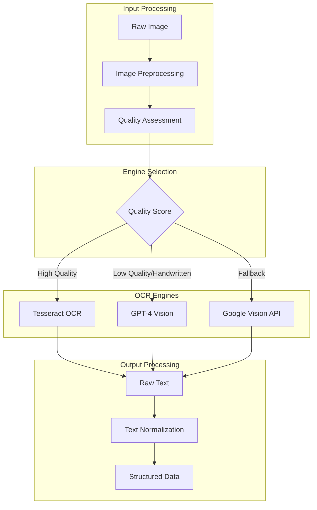

#### 3.2 Image Preprocessing

```python
# core/ocr/preprocessing.py
class ImagePreprocessor:
    """Preprocesses images for optimal OCR performance."""
    
    def preprocess(self, image_path: str) -> ProcessedImage:
        """
        Apply preprocessing pipeline:
        1. Convert to grayscale
        2. Deskew (correct rotation)
        3. Remove noise (Gaussian blur + threshold)
        4. Enhance contrast (CLAHE)
        5. Binarization (Otsu's method)
        """
        
    def assess_quality(self, image: np.ndarray) -> QualityScore:
        """
        Assess image quality for OCR engine selection.
        
        Metrics:
        - Sharpness (Laplacian variance)
        - Contrast ratio
        - Noise level
        - Text density estimation
        """
```


#### 3.3 Tesseract Integration

```python
# core/ocr/tesseract.py
class TesseractEngine:
    """Tesseract OCR engine for high-quality printed documents."""
    
    def __init__(self, lang: str = 'eng', config: str = '--psm 6'):
        self.lang = lang
        self.config = config
    
    def extract_text(self, image: np.ndarray) -> OCRResult:
        """Extract text using Tesseract with confidence scores."""
        data = pytesseract.image_to_data(
            image, 
            lang=self.lang, 
            config=self.config,
            output_type=pytesseract.Output.DICT
        )
        return self._parse_tesseract_output(data)
    
    def extract_tables(self, image: np.ndarray) -> List[Table]:
        """Extract tabular data from result sheets."""
```

#### 3.4 GPT-4 Vision Integration

```python
# core/ocr/vision.py
class GPT4VisionEngine:
    """GPT-4 Vision for complex/handwritten document understanding."""
    
    EXTRACTION_PROMPT = """
    Analyze this Nigerian election result sheet image and extract:
    1. All political party names and their abbreviations
    2. Vote count for each party (numeric values only)
    3. Total accredited voters
    4. Total valid votes
    5. Total rejected/invalid votes
    
    Return as JSON:
    {
        "parties": [{"name": "...", "code": "...", "votes": 0}],
        "accredited_voters": 0,
        "valid_votes": 0,
        "rejected_votes": 0,
        "confidence": 0.0
    }
    """
    
    async def extract(self, image_path: str) -> ExtractionResult:
        """Extract election data using GPT-4 Vision."""
        base64_image = self._encode_image(image_path)
        
        response = await self.client.chat.completions.create(
            model="gpt-4-vision-preview",
            messages=[{
                "role": "user",
                "content": [
                    {"type": "text", "text": self.EXTRACTION_PROMPT},
                    {"type": "image_url", "image_url": {
                        "url": f"data:image/jpeg;base64,{base64_image}"
                    }}
                ]
            }],
            max_tokens=1000
        )
        return self._parse_response(response)
```

---


### 4. System Design

#### 4.1 Component Interaction Diagram

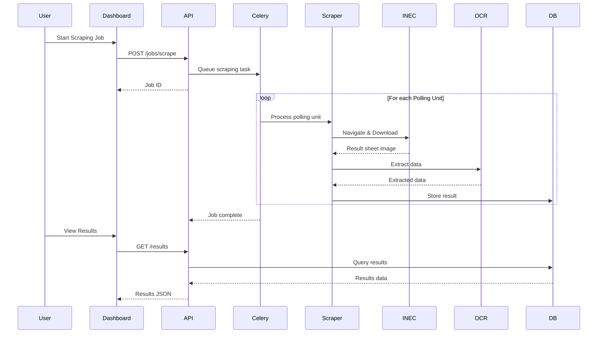

#### 4.2 Deployment Architecture

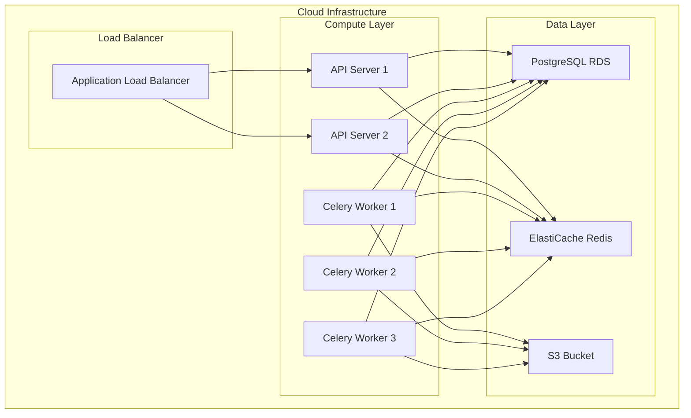


#### 4.3 State Management

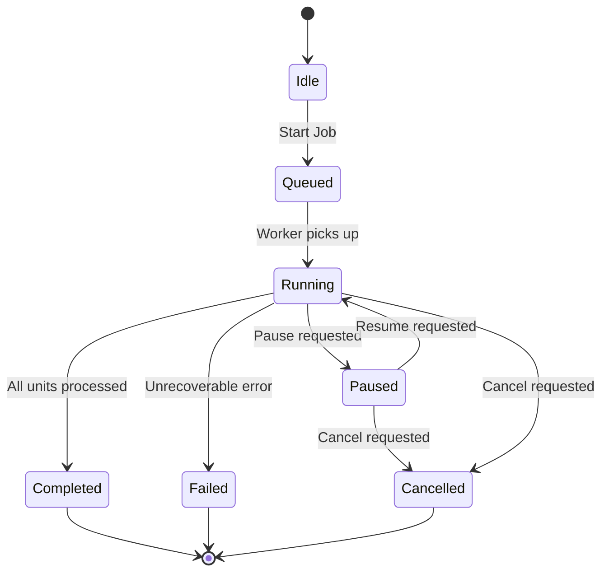

#### 4.4 Scraping Progress Persistence

```python
# models/job.py
class ScrapingJob(Base):
    """Tracks scraping job state for pause/resume functionality."""
    
    __tablename__ = "scraping_jobs"
    
    id = Column(UUID, primary_key=True, default=uuid4)
    status = Column(Enum(JobStatus), default=JobStatus.QUEUED)
    
    # Scope configuration
    election_type = Column(String, nullable=True)  # None = all types
    target_state = Column(String, nullable=True)   # None = all states
    target_lga = Column(String, nullable=True)     # None = all LGAs
    target_ward = Column(String, nullable=True)    # None = all wards
    
    # Progress tracking
    total_polling_units = Column(Integer, default=0)
    processed_count = Column(Integer, default=0)
    success_count = Column(Integer, default=0)
    failed_count = Column(Integer, default=0)
    
    # Checkpoint for resume
    last_processed_pu = Column(String, nullable=True)
    checkpoint_data = Column(JSONB, nullable=True)
    
    # Timestamps
    created_at = Column(DateTime, default=datetime.utcnow)
    started_at = Column(DateTime, nullable=True)
    completed_at = Column(DateTime, nullable=True)
```

---


### 5. AI Model Design

#### 5.1 Document Understanding Pipeline

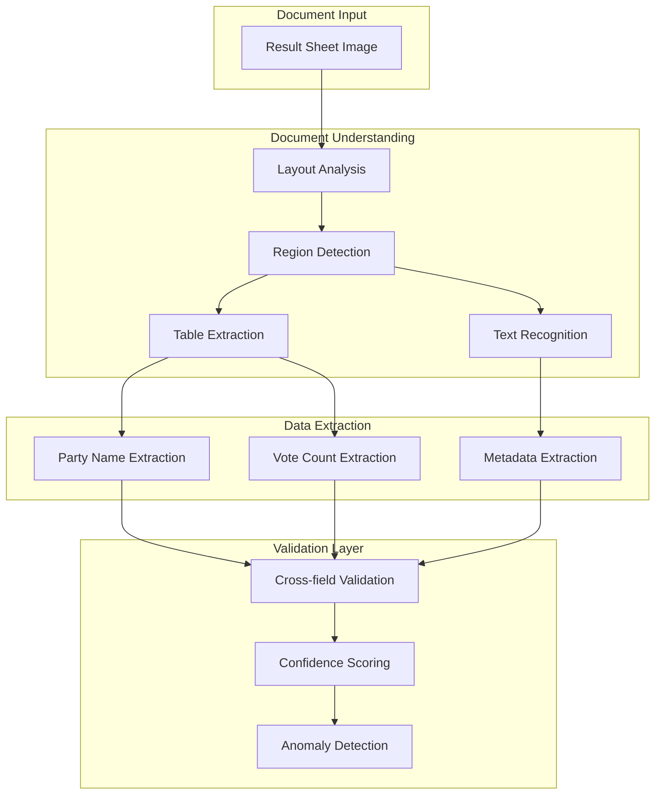

#### 5.2 Data Extraction Model

```python
# core/extractor/parser.py
class ElectionDataExtractor:
    """Extracts structured election data from OCR output."""
    
    # Known Nigerian political parties
    PARTY_PATTERNS = {
        'APC': r'(?:APC|All\s*Progressives?\s*Congress)',
        'PDP': r'(?:PDP|Peoples?\s*Democratic\s*Party)',
        'LP': r'(?:LP|Labour\s*Party)',
        'NNPP': r'(?:NNPP|New\s*Nigeria\s*Peoples?\s*Party)',
        'APGA': r'(?:APGA|All\s*Progressives?\s*Grand\s*Alliance)',
        # ... additional parties
    }
    
    def extract(self, ocr_result: OCRResult) -> ExtractionResult:
        """
        Extract election data from OCR result.
        
        Steps:
        1. Identify table regions
        2. Extract party names using pattern matching
        3. Extract vote counts adjacent to party names
        4. Extract summary fields (accredited, valid, rejected)
        5. Validate extracted data
        """
        
    def _extract_party_votes(self, text: str) -> List[PartyVote]:
        """Extract party names and vote counts using regex patterns."""
        
    def _extract_summary_fields(self, text: str) -> SummaryFields:
        """Extract accredited voters, valid votes, rejected votes."""
```


#### 5.3 Validation Model

```python
# core/extractor/validator.py
class DataValidator:
    """Validates extracted election data for consistency."""
    
    VOTE_SUM_TOLERANCE = 2  # Allow ±2 votes for rounding errors
    
    def validate(self, result: ExtractionResult) -> ValidationResult:
        """
        Validate extracted data:
        1. Sum of party votes ≈ valid votes (within tolerance)
        2. Valid votes + rejected votes ≤ accredited voters
        3. All vote counts are non-negative
        4. Party names are recognized
        """
        errors = []
        warnings = []
        
        # Validate vote sum
        party_sum = sum(p.votes for p in result.parties)
        if abs(party_sum - result.valid_votes) > self.VOTE_SUM_TOLERANCE:
            errors.append(ValidationError(
                field="party_votes",
                message=f"Sum {party_sum} != valid votes {result.valid_votes}"
            ))
        
        # Validate totals
        total_votes = result.valid_votes + result.rejected_votes
        if total_votes > result.accredited_voters:
            errors.append(ValidationError(
                field="totals",
                message="Total votes exceed accredited voters"
            ))
        
        return ValidationResult(
            is_valid=len(errors) == 0,
            errors=errors,
            warnings=warnings,
            confidence=self._calculate_confidence(result, errors)
        )
    
    def _calculate_confidence(
        self, result: ExtractionResult, errors: List[ValidationError]
    ) -> float:
        """Calculate confidence score based on validation results."""
        base_confidence = result.ocr_confidence
        penalty = len(errors) * 0.1
        return max(0.0, min(1.0, base_confidence - penalty))
```

#### 5.4 Confidence Scoring

| Factor | Weight | Description |
|--------|--------|-------------|
| OCR Confidence | 0.4 | Average character confidence from OCR engine |
| Validation Pass | 0.3 | All validation rules passed |
| Party Recognition | 0.2 | All parties matched known patterns |
| Image Quality | 0.1 | Preprocessing quality assessment |

---


### 6. Database Design

#### 6.1 Entity Relationship Diagram

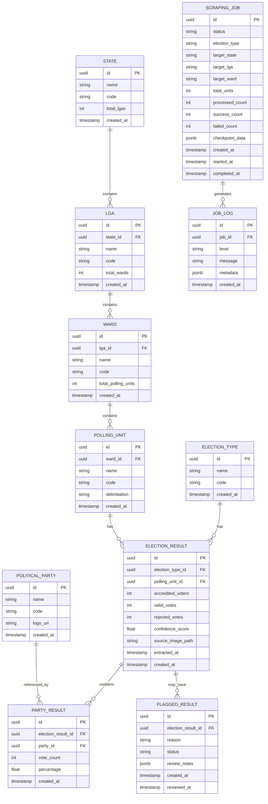


#### 6.2 Table Definitions

```sql
-- Geographic hierarchy tables
CREATE TABLE states (
    id UUID PRIMARY KEY DEFAULT gen_random_uuid(),
    name VARCHAR(100) NOT NULL UNIQUE,
    code VARCHAR(10) NOT NULL UNIQUE,
    total_lgas INTEGER DEFAULT 0,
    created_at TIMESTAMP DEFAULT CURRENT_TIMESTAMP
);

CREATE TABLE lgas (
    id UUID PRIMARY KEY DEFAULT gen_random_uuid(),
    state_id UUID NOT NULL REFERENCES states(id),
    name VARCHAR(100) NOT NULL,
    code VARCHAR(20) NOT NULL,
    total_wards INTEGER DEFAULT 0,
    created_at TIMESTAMP DEFAULT CURRENT_TIMESTAMP,
    UNIQUE(state_id, code)
);

CREATE TABLE wards (
    id UUID PRIMARY KEY DEFAULT gen_random_uuid(),
    lga_id UUID NOT NULL REFERENCES lgas(id),
    name VARCHAR(100) NOT NULL,
    code VARCHAR(30) NOT NULL,
    total_polling_units INTEGER DEFAULT 0,
    created_at TIMESTAMP DEFAULT CURRENT_TIMESTAMP,
    UNIQUE(lga_id, code)
);

CREATE TABLE polling_units (
    id UUID PRIMARY KEY DEFAULT gen_random_uuid(),
    ward_id UUID NOT NULL REFERENCES wards(id),
    name VARCHAR(200) NOT NULL,
    code VARCHAR(50) NOT NULL,
    delimitation VARCHAR(100),
    created_at TIMESTAMP DEFAULT CURRENT_TIMESTAMP,
    UNIQUE(ward_id, code)
);

-- Election and results tables
CREATE TABLE election_types (
    id UUID PRIMARY KEY DEFAULT gen_random_uuid(),
    name VARCHAR(100) NOT NULL UNIQUE,
    code VARCHAR(30) NOT NULL UNIQUE,
    created_at TIMESTAMP DEFAULT CURRENT_TIMESTAMP
);

CREATE TABLE political_parties (
    id UUID PRIMARY KEY DEFAULT gen_random_uuid(),
    name VARCHAR(200) NOT NULL,
    code VARCHAR(20) NOT NULL UNIQUE,
    logo_url VARCHAR(500),
    created_at TIMESTAMP DEFAULT CURRENT_TIMESTAMP
);

CREATE TABLE election_results (
    id UUID PRIMARY KEY DEFAULT gen_random_uuid(),
    election_type_id UUID NOT NULL REFERENCES election_types(id),
    polling_unit_id UUID NOT NULL REFERENCES polling_units(id),
    accredited_voters INTEGER NOT NULL DEFAULT 0,
    valid_votes INTEGER NOT NULL DEFAULT 0,
    rejected_votes INTEGER NOT NULL DEFAULT 0,
    confidence_score DECIMAL(3,2) DEFAULT 0.00,
    source_image_path VARCHAR(500),
    extracted_at TIMESTAMP DEFAULT CURRENT_TIMESTAMP,
    created_at TIMESTAMP DEFAULT CURRENT_TIMESTAMP,
    updated_at TIMESTAMP DEFAULT CURRENT_TIMESTAMP,
    UNIQUE(election_type_id, polling_unit_id)
);

CREATE TABLE party_results (
    id UUID PRIMARY KEY DEFAULT gen_random_uuid(),
    election_result_id UUID NOT NULL REFERENCES election_results(id) ON DELETE CASCADE,
    party_id UUID NOT NULL REFERENCES political_parties(id),
    vote_count INTEGER NOT NULL DEFAULT 0,
    percentage DECIMAL(5,2) DEFAULT 0.00,
    created_at TIMESTAMP DEFAULT CURRENT_TIMESTAMP,
    UNIQUE(election_result_id, party_id)
);
```


```sql
-- Job management tables
CREATE TABLE scraping_jobs (
    id UUID PRIMARY KEY DEFAULT gen_random_uuid(),
    status VARCHAR(20) NOT NULL DEFAULT 'queued',
    election_type VARCHAR(50),
    target_state VARCHAR(100),
    target_lga VARCHAR(100),
    target_ward VARCHAR(100),
    total_polling_units INTEGER DEFAULT 0,
    processed_count INTEGER DEFAULT 0,
    success_count INTEGER DEFAULT 0,
    failed_count INTEGER DEFAULT 0,
    last_processed_pu VARCHAR(100),
    checkpoint_data JSONB,
    created_at TIMESTAMP DEFAULT CURRENT_TIMESTAMP,
    started_at TIMESTAMP,
    completed_at TIMESTAMP
);

CREATE TABLE job_logs (
    id UUID PRIMARY KEY DEFAULT gen_random_uuid(),
    job_id UUID NOT NULL REFERENCES scraping_jobs(id) ON DELETE CASCADE,
    level VARCHAR(10) NOT NULL,
    message TEXT NOT NULL,
    metadata JSONB,
    created_at TIMESTAMP DEFAULT CURRENT_TIMESTAMP
);

CREATE TABLE flagged_results (
    id UUID PRIMARY KEY DEFAULT gen_random_uuid(),
    election_result_id UUID NOT NULL REFERENCES election_results(id),
    reason VARCHAR(50) NOT NULL,
    status VARCHAR(20) DEFAULT 'pending',
    review_notes JSONB,
    created_at TIMESTAMP DEFAULT CURRENT_TIMESTAMP,
    reviewed_at TIMESTAMP
);

-- Indexes for query performance
CREATE INDEX idx_lgas_state ON lgas(state_id);
CREATE INDEX idx_wards_lga ON wards(lga_id);
CREATE INDEX idx_polling_units_ward ON polling_units(ward_id);
CREATE INDEX idx_election_results_type ON election_results(election_type_id);
CREATE INDEX idx_election_results_pu ON election_results(polling_unit_id);
CREATE INDEX idx_party_results_election ON party_results(election_result_id);
CREATE INDEX idx_party_results_party ON party_results(party_id);
CREATE INDEX idx_job_logs_job ON job_logs(job_id);
CREATE INDEX idx_flagged_results_status ON flagged_results(status);
```

#### 6.3 Aggregation Views

```sql
-- Ward-level aggregation view
CREATE VIEW ward_aggregation AS
SELECT 
    w.id AS ward_id,
    w.name AS ward_name,
    l.name AS lga_name,
    s.name AS state_name,
    et.code AS election_type,
    pp.code AS party_code,
    pp.name AS party_name,
    SUM(pr.vote_count) AS total_votes,
    COUNT(DISTINCT er.polling_unit_id) AS polling_units_counted,
    w.total_polling_units AS total_polling_units
FROM wards w
JOIN lgas l ON w.lga_id = l.id
JOIN states s ON l.state_id = s.id
JOIN polling_units pu ON pu.ward_id = w.id
JOIN election_results er ON er.polling_unit_id = pu.id
JOIN election_types et ON er.election_type_id = et.id
JOIN party_results pr ON pr.election_result_id = er.id
JOIN political_parties pp ON pr.party_id = pp.id
GROUP BY w.id, w.name, l.name, s.name, et.code, pp.code, pp.name, w.total_polling_units;

-- LGA-level aggregation view
CREATE VIEW lga_aggregation AS
SELECT 
    l.id AS lga_id,
    l.name AS lga_name,
    s.name AS state_name,
    et.code AS election_type,
    pp.code AS party_code,
    pp.name AS party_name,
    SUM(pr.vote_count) AS total_votes,
    COUNT(DISTINCT er.polling_unit_id) AS polling_units_counted
FROM lgas l
JOIN states s ON l.state_id = s.id
JOIN wards w ON w.lga_id = l.id
JOIN polling_units pu ON pu.ward_id = w.id
JOIN election_results er ON er.polling_unit_id = pu.id
JOIN election_types et ON er.election_type_id = et.id
JOIN party_results pr ON pr.election_result_id = er.id
JOIN political_parties pp ON pr.party_id = pp.id
GROUP BY l.id, l.name, s.name, et.code, pp.code, pp.name;
```

---


### 7. Agentic Formation

#### 7.1 Multi-Agent Architecture

The system uses a hierarchical multi-agent architecture built on LangGraph for coordinating parallel processing of election data.

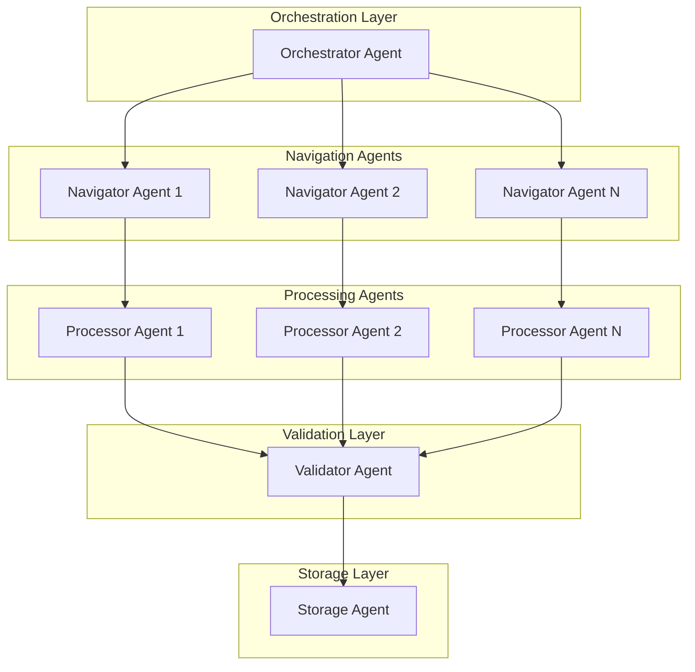

#### 7.2 Agent Definitions

```python
# agents/orchestrator.py
class OrchestratorAgent:
    """
    Central coordinator that manages the scraping workflow.
    
    Responsibilities:
    - Distribute work across navigator agents
    - Monitor progress and handle failures
    - Manage job state and checkpoints
    - Coordinate pause/resume operations
    """
    
    def __init__(self, config: AgentConfig):
        self.navigator_pool = NavigatorPool(config.max_navigators)
        self.processor_pool = ProcessorPool(config.max_processors)
        self.state_manager = StateManager()
    
    async def execute_job(self, job: ScrapingJob) -> JobResult:
        """Execute a scraping job with parallel processing."""
        
    async def distribute_work(self, units: List[PollingUnit]) -> None:
        """Distribute polling units across navigator agents."""
        
    async def handle_failure(self, unit: PollingUnit, error: Exception) -> None:
        """Handle processing failure with retry or flagging."""
```


```python
# agents/navigator.py
class NavigatorAgent:
    """
    Handles portal navigation and image downloading.
    
    Responsibilities:
    - Navigate INEC portal hierarchy
    - Download result sheet images
    - Handle navigation errors and retries
    - Report progress to orchestrator
    """
    
    def __init__(self, browser: BrowserManager):
        self.browser = browser
        self.downloader = ResultSheetDownloader()
    
    async def process_unit(self, unit: PollingUnit) -> NavigationResult:
        """Navigate to polling unit and download result sheet."""
        
    async def navigate_hierarchy(
        self, election_type: str, state: str, lga: str, ward: str
    ) -> List[PollingUnit]:
        """Navigate portal hierarchy to discover polling units."""


# agents/processor.py
class ProcessorAgent:
    """
    Handles OCR and data extraction from result sheets.
    
    Responsibilities:
    - Preprocess images for OCR
    - Execute OCR pipeline
    - Extract structured data
    - Initial validation
    """
    
    def __init__(self, ocr_engine: OCREngine, extractor: DataExtractor):
        self.ocr_engine = ocr_engine
        self.extractor = extractor
    
    async def process_image(self, image_path: str) -> ProcessingResult:
        """Process result sheet image and extract data."""
        
    def select_ocr_engine(self, quality_score: float) -> OCREngine:
        """Select appropriate OCR engine based on image quality."""


# agents/validator.py
class ValidatorAgent:
    """
    Validates extracted data and flags anomalies.
    
    Responsibilities:
    - Cross-field validation
    - Anomaly detection
    - Confidence scoring
    - Flag results for manual review
    """
    
    def __init__(self, validator: DataValidator):
        self.validator = validator
    
    async def validate(self, result: ExtractionResult) -> ValidationResult:
        """Validate extracted election data."""
        
    async def flag_for_review(
        self, result: ExtractionResult, reason: str
    ) -> None:
        """Flag result for manual review."""
```


#### 7.3 Agent Communication Protocol

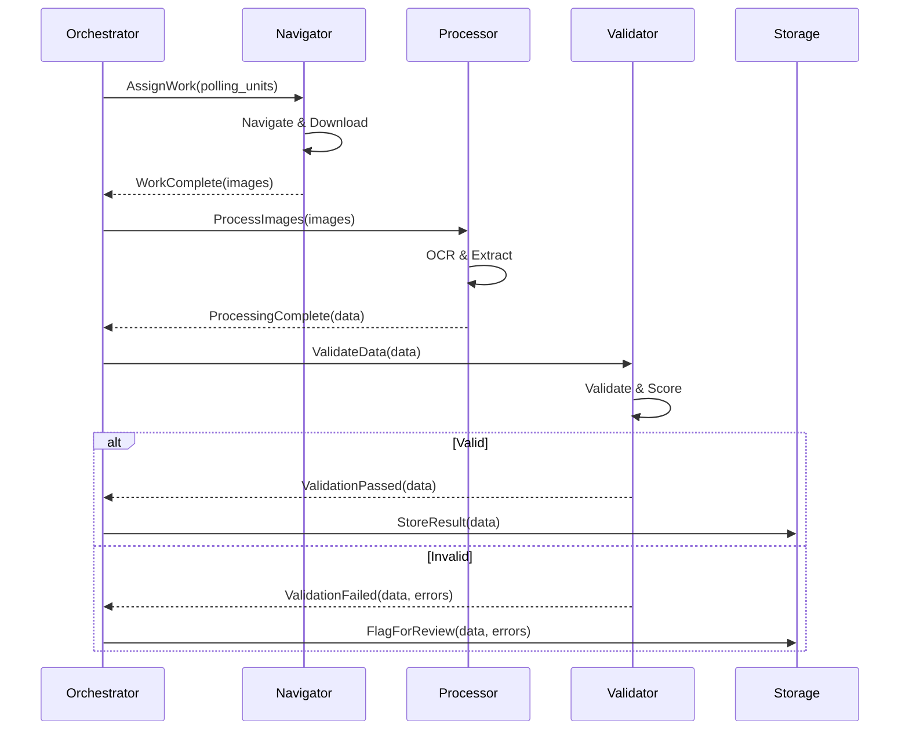

#### 7.4 LangGraph State Machine

```python
# agents/graph.py
from langgraph.graph import StateGraph, END

class AgentState(TypedDict):
    """State shared across agents in the workflow."""
    job_id: str
    current_unit: Optional[PollingUnit]
    image_path: Optional[str]
    ocr_result: Optional[OCRResult]
    extraction_result: Optional[ExtractionResult]
    validation_result: Optional[ValidationResult]
    errors: List[str]
    status: str

def create_agent_graph() -> StateGraph:
    """Create the LangGraph workflow for election data processing."""
    
    workflow = StateGraph(AgentState)
    
    # Add nodes
    workflow.add_node("navigate", navigate_node)
    workflow.add_node("download", download_node)
    workflow.add_node("preprocess", preprocess_node)
    workflow.add_node("ocr", ocr_node)
    workflow.add_node("extract", extract_node)
    workflow.add_node("validate", validate_node)
    workflow.add_node("store", store_node)
    workflow.add_node("flag", flag_node)
    
    # Add edges
    workflow.add_edge("navigate", "download")
    workflow.add_edge("download", "preprocess")
    workflow.add_edge("preprocess", "ocr")
    workflow.add_edge("ocr", "extract")
    workflow.add_edge("extract", "validate")
    
    # Conditional edges
    workflow.add_conditional_edges(
        "validate",
        lambda state: "store" if state["validation_result"].is_valid else "flag",
        {"store": "store", "flag": "flag"}
    )
    
    workflow.add_edge("store", END)
    workflow.add_edge("flag", END)
    
    workflow.set_entry_point("navigate")
    
    return workflow.compile()
```


#### 7.5 Parallel Processing Strategy

```python
# agents/pool.py
class AgentPool:
    """Manages a pool of agents for parallel processing."""
    
    def __init__(self, agent_class: Type[Agent], pool_size: int):
        self.agents = [agent_class() for _ in range(pool_size)]
        self.semaphore = asyncio.Semaphore(pool_size)
        self.task_queue = asyncio.Queue()
    
    async def submit(self, task: Task) -> None:
        """Submit a task to the pool."""
        await self.task_queue.put(task)
    
    async def process_batch(self, tasks: List[Task]) -> List[Result]:
        """Process a batch of tasks in parallel."""
        async with asyncio.TaskGroup() as tg:
            futures = [
                tg.create_task(self._process_with_agent(task))
                for task in tasks
            ]
        return [f.result() for f in futures]
    
    async def _process_with_agent(self, task: Task) -> Result:
        """Process a single task with an available agent."""
        async with self.semaphore:
            agent = await self._get_available_agent()
            try:
                return await agent.process(task)
            finally:
                await self._release_agent(agent)
```

#### 7.6 Agent Configuration

```yaml
# config/agents.yaml
orchestrator:
  max_concurrent_jobs: 3
  checkpoint_interval: 100  # Save checkpoint every 100 units
  failure_threshold: 0.1    # Flag job if >10% failures

navigator:
  pool_size: 5
  request_delay: 1.0        # Seconds between requests
  max_retries: 5
  backoff_factor: 2.0

processor:
  pool_size: 10
  ocr_timeout: 30           # Seconds
  quality_threshold: 0.7    # Use GPT-4V below this

validator:
  vote_sum_tolerance: 2
  min_confidence: 0.6
  auto_flag_threshold: 0.4

storage:
  batch_size: 50
  flush_interval: 10        # Seconds
```

---

## Data Models

### Core Domain Models

```python
# models/domain.py
from pydantic import BaseModel, Field
from typing import List, Optional
from datetime import datetime
from enum import Enum

class ElectionType(str, Enum):
    PRESIDENTIAL = "presidential"
    GOVERNORSHIP = "governorship"
    SENATORIAL = "senatorial"
    HOUSE_OF_REPS = "house_of_reps"
    HOUSE_OF_ASSEMBLY = "house_of_assembly"
    CHAIRMANSHIP = "chairmanship"
    COUNCILOR = "councilor"

class JobStatus(str, Enum):
    QUEUED = "queued"
    RUNNING = "running"
    PAUSED = "paused"
    COMPLETED = "completed"
    FAILED = "failed"
    CANCELLED = "cancelled"


```python
class PollingUnit(BaseModel):
    id: str
    name: str
    code: str
    ward_id: str
    ward_name: str
    lga_id: str
    lga_name: str
    state_id: str
    state_name: str
    delimitation: Optional[str] = None

class PartyVote(BaseModel):
    party_id: str
    party_name: str
    party_code: str
    vote_count: int
    percentage: float = 0.0

class ElectionResult(BaseModel):
    id: str
    election_type: ElectionType
    polling_unit: PollingUnit
    party_votes: List[PartyVote]
    accredited_voters: int
    valid_votes: int
    rejected_votes: int
    confidence_score: float = Field(ge=0.0, le=1.0)
    source_image_path: str
    extracted_at: datetime
    is_flagged: bool = False
    flag_reason: Optional[str] = None

class AggregatedResult(BaseModel):
    level: str  # 'ward', 'lga', 'state'
    location_id: str
    location_name: str
    election_type: ElectionType
    party_totals: List[PartyVote]
    total_valid_votes: int
    total_rejected_votes: int
    total_accredited_voters: int
    polling_units_counted: int
    polling_units_total: int
    polling_units_flagged: int

class ScrapingJobConfig(BaseModel):
    election_type: Optional[ElectionType] = None
    target_state: Optional[str] = None
    target_lga: Optional[str] = None
    target_ward: Optional[str] = None

class ScrapingJobProgress(BaseModel):
    job_id: str
    status: JobStatus
    total_units: int
    processed: int
    successful: int
    failed: int
    progress_percentage: float
    estimated_time_remaining: Optional[int] = None  # seconds
    last_processed_unit: Optional[str] = None
```

---


## Correctness Properties

*A property is a characteristic or behavior that should hold true across all valid executions of a system—essentially, a formal statement about what the system should do. Properties serve as the bridge between human-readable specifications and machine-verifiable correctness guarantees.*

### Property Reflection

After analyzing the acceptance criteria, the following redundancies were identified and consolidated:

- Requirements 3.3, 3.4, 3.5 (extract accredited/valid/rejected votes) are consolidated into a single extraction completeness property
- Requirements 1.7, 2.4, 7.3 (retry with backoff) are consolidated into a single retry behavior property
- Requirements 3.6, 3.7 (flag for manual review) are consolidated into a single flagging property
- Requirements 5.1, 5.2 (ward/LGA aggregation) follow the same pattern and are consolidated
- Requirements 4.1, 4.5 (store with required fields/metadata) are consolidated into storage completeness

### Property 1: Navigation Hierarchy Completeness

*For any* election type, navigating to states should return exactly 37 entries (36 states + FCT), and *for any* state, LGA, or ward in the hierarchy, navigating to the next level should return a non-empty list of child entities.

**Validates: Requirements 1.3, 1.4, 1.5, 1.6**

### Property 2: Retry with Exponential Backoff

*For any* network failure during portal access or download, the system should retry up to the configured maximum attempts with exponentially increasing delays between attempts.

**Validates: Requirements 1.7, 2.4, 7.3**

### Property 3: Filename Encoding Hierarchy

*For any* downloaded result sheet, the filename should contain and allow reconstruction of the complete location hierarchy: election type, state, LGA, ward, and polling unit identifiers.

**Validates: Requirements 2.3**

### Property 4: Progress Tracking Accuracy

*For any* scraping session, the sum of successful downloads plus failed downloads should equal the total processed count, and the progress percentage should accurately reflect processed/total ratio.

**Validates: Requirements 2.6**


### Property 5: OCR Text Extraction

*For any* valid result sheet image (PDF or PNG), the OCR engine should produce non-empty text output containing recognizable election-related content.

**Validates: Requirements 3.1**

### Property 6: Data Extraction Completeness

*For any* OCR output from a valid result sheet, the data extractor should identify and extract: at least one party with vote count, accredited voters count, valid votes count, and rejected votes count.

**Validates: Requirements 3.2, 3.3, 3.4, 3.5**

### Property 7: Vote Sum Validation

*For any* extracted election result, the sum of all party vote counts should equal the total valid votes within a tolerance of ±2 votes.

**Validates: Requirements 3.8**

### Property 8: Flagging for Manual Review

*For any* result sheet that cannot be read by OCR or cannot be parsed for party names/vote counts, the system should flag the result for manual review with an appropriate reason code.

**Validates: Requirements 3.6, 3.7**

### Property 9: Database Storage Completeness

*For any* successfully extracted result, the database record should contain all required fields: election type, state, LGA, ward, polling unit, party results, accredited voters, valid votes, rejected votes, extraction timestamp, source image path, and confidence score.

**Validates: Requirements 4.1, 4.5**

### Property 10: Database Upsert Behavior

*For any* election result with the same election type and polling unit combination, inserting a new record should update the existing record rather than creating a duplicate.

**Validates: Requirements 4.3, 4.4**

### Property 11: Query Filter Correctness

*For any* query with filters on election type, state, LGA, ward, or polling unit, all returned results should match the specified filter criteria.

**Validates: Requirements 4.6**


### Property 12: Aggregation Sum Correctness

*For any* ward or LGA aggregation, the total votes for each party should equal the sum of votes from all constituent polling units (for ward) or wards (for LGA).

**Validates: Requirements 5.1, 5.2**

### Property 13: Percentage Calculation

*For any* aggregated result, the sum of all party vote percentages should equal 100% (within rounding tolerance of ±0.1%).

**Validates: Requirements 5.3**

### Property 14: Party Ranking Order

*For any* aggregated result, parties should be ordered by vote count in strictly descending order.

**Validates: Requirements 5.4**

### Property 15: Aggregation Count Accuracy

*For any* aggregation, the reported total polling units should equal the actual count of polling units in the aggregation scope, and the flagged count should equal the actual count of flagged results.

**Validates: Requirements 5.5, 5.6**

### Property 16: Pause/Resume Round Trip

*For any* scraping job that is paused and then resumed, the job should continue from the last checkpoint without reprocessing already-completed polling units and without skipping unprocessed units.

**Validates: Requirements 6.3, 6.4**

### Property 17: Rate Limiting Enforcement

*For any* sequence of requests to the INEC portal, the time between consecutive requests should be at least the configured minimum delay.

**Validates: Requirements 6.5**

### Property 18: Log Entry Completeness

*For any* logged operation, the log entry should contain a timestamp, operation type, and status, with errors properly categorized as network, parsing, or validation errors.

**Validates: Requirements 7.1, 7.2**


### Property 19: Session Summary Accuracy

*For any* completed scraping session, the summary report totals (processed, successful, failed) should match the actual counts of items in each category.

**Validates: Requirements 7.4**

### Property 20: Failed Items Queue

*For any* failed processing attempt, the failed item should be stored in the retry queue and be retrievable for manual review or retry.

**Validates: Requirements 7.5**

### Property 21: CSV Export Validity

*For any* CSV export, the output should be valid CSV format with headers matching the data columns, and all exported records should match the specified filter criteria.

**Validates: Requirements 8.1, 8.3**

### Property 22: JSON Export Round Trip

*For any* JSON export, parsing the exported JSON should produce data equivalent to the original aggregated results, including all metadata fields.

**Validates: Requirements 8.2, 8.4**

### Property 23: Export Filter Correctness

*For any* export with filters on election type, state, LGA, or ward, all exported records should match the specified filter criteria and no matching records should be omitted.

**Validates: Requirements 8.3**

---


## Error Handling

### Error Categories

| Category | Examples | Handling Strategy |
|----------|----------|-------------------|
| Network Errors | Connection timeout, DNS failure, HTTP 5xx | Retry with exponential backoff (max 5 attempts) |
| Portal Errors | Page not found, element not found | Log and skip, continue to next item |
| Download Errors | File not available, corrupt download | Retry 3 times, then flag as missing |
| OCR Errors | Unreadable image, low confidence | Try alternate OCR engine, then flag for review |
| Parsing Errors | Unrecognized format, missing fields | Flag for manual review |
| Validation Errors | Vote sum mismatch, negative values | Flag for manual review with error details |
| Database Errors | Connection failure, constraint violation | Retry with backoff, alert on persistent failure |

### Error Response Flow

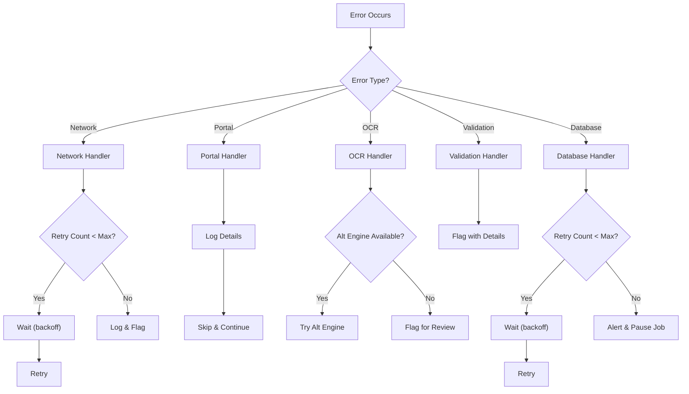

### Logging Configuration

```python
# config/logging.py
LOGGING_CONFIG = {
    "version": 1,
    "disable_existing_loggers": False,
    "formatters": {
        "standard": {
            "format": "%(asctime)s [%(levelname)s] %(name)s: %(message)s"
        },
        "json": {
            "class": "pythonjsonlogger.jsonlogger.JsonFormatter",
            "format": "%(asctime)s %(levelname)s %(name)s %(message)s"
        }
    },
    "handlers": {
        "console": {
            "class": "logging.StreamHandler",
            "formatter": "standard",
            "level": "INFO"
        },
        "file": {
            "class": "logging.handlers.RotatingFileHandler",
            "filename": "logs/agent.log",
            "maxBytes": 10485760,  # 10MB
            "backupCount": 5,
            "formatter": "json",
            "level": "DEBUG"
        }
    },
    "loggers": {
        "inec_agent": {
            "handlers": ["console", "file"],
            "level": "DEBUG",
            "propagate": False
        }
    }
}
```

---


## Testing Strategy

### Dual Testing Approach

This system requires both unit tests and property-based tests for comprehensive coverage:

- **Unit tests**: Verify specific examples, edge cases, integration points, and error conditions
- **Property tests**: Verify universal properties across all valid inputs using randomized testing

### Property-Based Testing Configuration

- **Library**: Hypothesis (Python)
- **Minimum iterations**: 100 per property test
- **Tag format**: `Feature: inec-election-results-agent, Property {number}: {property_text}`

### Test Categories

| Category | Type | Coverage |
|----------|------|----------|
| Navigation | Property + Unit | Hierarchy traversal, error handling |
| Download | Property + Unit | File formats, retry logic, filename encoding |
| OCR | Property + Unit | Text extraction, engine selection |
| Extraction | Property + Unit | Data parsing, validation |
| Database | Property + Unit | CRUD operations, upsert, queries |
| Aggregation | Property + Unit | Sum correctness, percentages, ranking |
| Export | Property + Unit | Format validity, filtering |
| Integration | Unit | End-to-end workflows |

### Example Property Test

```python
# tests/test_properties.py
from hypothesis import given, strategies as st, settings

class TestAggregationProperties:
    """
    Feature: inec-election-results-agent
    Property 12: Aggregation Sum Correctness
    """
    
    @settings(max_examples=100)
    @given(
        polling_units=st.lists(
            st.builds(
                PollingUnitResult,
                party_votes=st.dictionaries(
                    st.sampled_from(['APC', 'PDP', 'LP', 'NNPP']),
                    st.integers(min_value=0, max_value=1000)
                )
            ),
            min_size=1,
            max_size=50
        )
    )
    def test_ward_aggregation_sum_equals_pu_sum(self, polling_units):
        """
        For any ward aggregation, total votes per party should equal
        sum of votes from all constituent polling units.
        """
        # Arrange
        ward = create_ward_with_results(polling_units)
        
        # Act
        aggregation = aggregator.aggregate_ward(ward.id)
        
        # Assert
        for party in aggregation.party_totals:
            expected = sum(
                pu.party_votes.get(party.code, 0) 
                for pu in polling_units
            )
            assert party.vote_count == expected
```


### Example Unit Tests

```python
# tests/test_extraction.py
class TestDataExtraction:
    """Unit tests for data extraction edge cases."""
    
    def test_extract_handles_empty_ocr_output(self):
        """Empty OCR output should flag for review."""
        result = extractor.extract("")
        assert result.is_flagged
        assert result.flag_reason == "empty_ocr_output"
    
    def test_extract_handles_partial_data(self):
        """Partial data should extract available fields and flag missing."""
        ocr_text = "APC: 150\nPDP: 200\nTotal Valid Votes: 350"
        result = extractor.extract(ocr_text)
        assert len(result.party_votes) == 2
        assert result.valid_votes == 350
        assert result.is_flagged  # Missing accredited/rejected
    
    def test_vote_sum_validation_within_tolerance(self):
        """Vote sum within ±2 tolerance should pass validation."""
        result = ExtractionResult(
            party_votes=[PartyVote("APC", 100), PartyVote("PDP", 99)],
            valid_votes=200  # Sum is 199, diff is 1
        )
        validation = validator.validate(result)
        assert validation.is_valid

    def test_vote_sum_validation_exceeds_tolerance(self):
        """Vote sum exceeding ±2 tolerance should fail validation."""
        result = ExtractionResult(
            party_votes=[PartyVote("APC", 100), PartyVote("PDP", 95)],
            valid_votes=200  # Sum is 195, diff is 5
        )
        validation = validator.validate(result)
        assert not validation.is_valid
        assert "vote_sum" in validation.errors[0].field
```

### Integration Test Example

```python
# tests/test_integration.py
class TestEndToEndWorkflow:
    """Integration tests for complete workflows."""
    
    @pytest.mark.integration
    async def test_scrape_single_polling_unit(self, test_db, mock_portal):
        """Test complete workflow for a single polling unit."""
        # Arrange
        mock_portal.setup_polling_unit("lagos", "ikeja", "ward1", "pu001")
        
        # Act
        job = await agent.scrape(
            election_type="presidential",
            target_state="lagos",
            target_lga="ikeja",
            target_ward="ward1"
        )
        await job.wait_for_completion()
        
        # Assert
        assert job.status == JobStatus.COMPLETED
        assert job.success_count == 1
        
        result = await db.get_result("presidential", "pu001")
        assert result is not None
        assert len(result.party_votes) > 0
```

### Test Data Generators

```python
# tests/generators.py
from hypothesis import strategies as st

# Generate valid party vote distributions
party_votes_strategy = st.dictionaries(
    keys=st.sampled_from(['APC', 'PDP', 'LP', 'NNPP', 'APGA']),
    values=st.integers(min_value=0, max_value=5000),
    min_size=2,
    max_size=10
)

# Generate valid election results
election_result_strategy = st.builds(
    ElectionResult,
    election_type=st.sampled_from(list(ElectionType)),
    party_votes=party_votes_strategy,
    accredited_voters=st.integers(min_value=100, max_value=10000),
    confidence_score=st.floats(min_value=0.0, max_value=1.0)
).filter(lambda r: r.valid_votes <= r.accredited_voters)

# Generate geographic hierarchy
state_strategy = st.sampled_from([
    "LAGOS", "KANO", "RIVERS", "KADUNA", "OGUN", "FCT"
])
```

---

## Appendix

### A. Nigerian Political Parties Reference

| Code | Full Name |
|------|-----------|
| APC | All Progressives Congress |
| PDP | Peoples Democratic Party |
| LP | Labour Party |
| NNPP | New Nigeria Peoples Party |
| APGA | All Progressives Grand Alliance |
| ADC | African Democratic Congress |
| SDP | Social Democratic Party |
| YPP | Young Progressives Party |
| AAC | African Action Congress |
| BOOT | Boot Party |

### B. INEC Portal URL Patterns

```
Base URL: https://www.inecelectionresults.ng

Election Types: /elections/types
States: /elections/{type}/states
LGAs: /elections/{type}/{state}/lgas
Wards: /elections/{type}/{state}/{lga}/wards
Polling Units: /elections/{type}/{state}/{lga}/{ward}/polling-units
Result Sheet: /elections/{type}/{state}/{lga}/{ward}/{pu}/result
```

### C. Result Sheet Field Mapping

| Field on Sheet | Database Column | Data Type |
|----------------|-----------------|-----------|
| Accredited Voters | accredited_voters | INTEGER |
| Total Valid Votes | valid_votes | INTEGER |
| Rejected Votes | rejected_votes | INTEGER |
| Party Name | party_name (via party_id) | VARCHAR |
| Party Score | vote_count | INTEGER |
