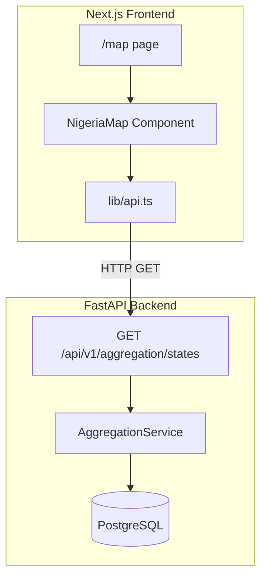
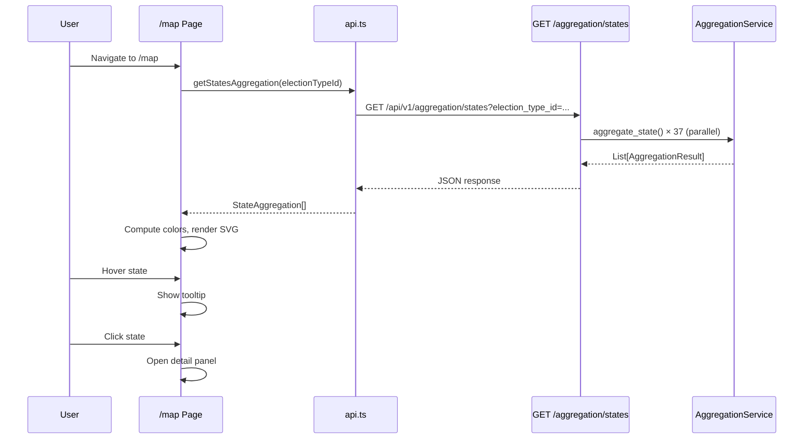
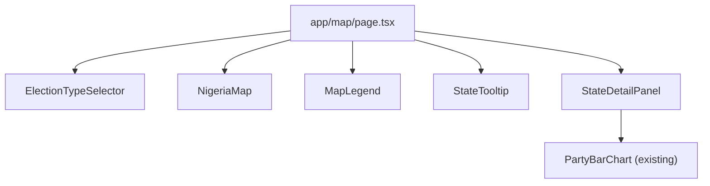

# Design Document: Interactive Nigeria Map with State-Level Election Results

## Overview

This feature adds an interactive SVG map of Nigeria to the election results dashboard, visualizing state-level aggregated election results. The map renders all 36 states plus FCT as clickable, hoverable regions color-coded by the leading party's vote share. A new bulk backend endpoint (`GET /api/v1/aggregation/states`) provides efficient data fetching for all states in a single request.

The map integrates into the existing Next.js frontend as a new `/map` route, reusing the existing design system (Radix UI, Tailwind CSS, Recharts) and connecting to the existing `AggregationService` on the backend.

### Key Design Decisions

| Decision | Choice | Rationale |
|----------|--------|-----------|
| SVG rendering approach | Pre-projected inline SVG paths | No extra dependencies (d3-geo), simpler rendering, smaller bundle. Recharts already bundles some d3 modules but not d3-geo projections. |
| Detail panel component | Radix Dialog (modal) | Already installed (`@radix-ui/react-dialog`), consistent with existing UI patterns, handles focus trapping and accessibility. |
| Data fetching strategy | Single bulk endpoint | 1 request vs 37 individual requests. Reduces latency and connection overhead. Backend uses `asyncio.gather` for parallel state aggregation. |
| Color scale algorithm | Linear interpolation on opacity/lightness | Simple, predictable, no extra dependencies. Maps vote share % to HSL lightness. |
| State management | React `useState` + prop drilling | Feature is self-contained; no need for global state. Selected state, hovered state, and election type are local to the map page. |
| SVG data source | Static TypeScript module with path data | Bundled at build time, no runtime fetch needed. Paths are pre-projected to a standard viewBox. |

## Architecture

### System Context



### Data Flow



### Integration with Existing Pages

The map page is added as a new navigation item in the existing `navItems` array in `frontend/app/layout.tsx`:

```typescript
{ href: '/map', label: 'Map', icon: '🗺️' }
```

The detail panel's "View LGA Breakdown" link navigates to the existing `/aggregation` page with a state filter query parameter.

## Components and Interfaces

### Frontend Component Hierarchy



### Component Specifications

#### `app/map/page.tsx` (Page Component)

Orchestrates the map feature. Manages state for:
- `selectedElectionTypeId: string | null` — currently selected election type
- `hoveredStateCode: string | null` — state code under cursor
- `selectedStateCode: string | null` — state code clicked for detail panel
- `stateAggregations: Map<string, StateAggregationData>` — fetched data keyed by state code
- `loading: boolean` — fetch in progress
- `error: string | null` — error message

```typescript
// Pseudocode structure
export default function MapPage() {
  // 1. Fetch election types on mount
  // 2. Default to presidential election type
  // 3. Fetch bulk state aggregations when election type changes
  // 4. Pass data down to child components
}
```

#### `NigeriaMap` Component

Props:
```typescript
interface NigeriaMapProps {
  stateAggregations: Map<string, StateAggregationData>;
  hoveredStateCode: string | null;
  selectedStateCode: string | null;
  onStateHover: (stateCode: string | null, event?: React.MouseEvent) => void;
  onStateClick: (stateCode: string) => void;
  onStateFocus: (stateCode: string | null) => void;
}
```

Renders an `<svg>` element with `viewBox="0 0 800 900"` (approximate Nigeria aspect ratio), `role="img"`, and `aria-label="Interactive map of Nigeria showing election results by state"`. Each state is a `<path>` with:
- `d` attribute from static path data
- `fill` computed by `getStateFillColor()`
- `data-state-code` attribute
- `tabIndex={0}` for keyboard navigation
- `aria-label` with state name and leading party info
- Mouse and keyboard event handlers

#### `StateTooltip` Component

Props:
```typescript
interface StateTooltipProps {
  stateCode: string;
  stateName: string;
  aggregation: StateAggregationData | null;
  position: { x: number; y: number };
  visible: boolean;
}
```

Renders a positioned `<div>` showing:
- State name (bold)
- Leading party: name + vote count
- Runner-up party: name + vote count
- Processing progress: "X / Y PUs reported"

Positioning logic uses `calculateTooltipPosition(cursorX, cursorY, tooltipWidth, tooltipHeight, viewportWidth, viewportHeight)` to keep the tooltip within viewport bounds.

#### `StateDetailPanel` Component

Built on `@radix-ui/react-dialog`. Props:
```typescript
interface StateDetailPanelProps {
  open: boolean;
  onClose: () => void;
  stateCode: string;
  stateName: string;
  aggregation: StateAggregationData;
}
```

Content sections:
1. Header: State name + election type
2. Summary stats: valid votes, rejected votes, accredited voters
3. Processing progress bar
4. Party results: horizontal bar chart (reuses existing `PartyBarChart`)
5. Flagged results count
6. Actions: "View LGA Breakdown" link, "Export" dropdown (CSV/JSON)

#### `MapLegend` Component

Props:
```typescript
interface MapLegendProps {
  className?: string;
}
```

Displays:
- Party color swatches with labels (APC, PDP, LP, NNPP, Others)
- Color intensity scale showing lighter → full saturation gradient
- "No data" gray indicator

#### `ElectionTypeSelector` Component

Props:
```typescript
interface ElectionTypeSelectorProps {
  electionTypes: ElectionTypeOption[];
  selectedId: string | null;
  onSelect: (id: string) => void;
  loading?: boolean;
}
```

Built on `@radix-ui/react-select`. Renders a dropdown above the map.

### Backend Endpoint

#### `GET /api/v1/aggregation/states`

Added to `backend/app/api/v1/aggregation.py`.

**Query Parameters:**
| Parameter | Type | Required | Description |
|-----------|------|----------|-------------|
| `election_type_id` | UUID | Yes | Election type to aggregate |

**Response:** `200 OK`
```json
[
  {
    "level": "state",
    "location_id": "uuid",
    "location_name": "Lagos",
    "election_type_id": "uuid",
    "election_type_code": "presidential",
    "party_results": [
      {
        "party_id": "uuid",
        "party_name": "All Progressives Congress",
        "party_code": "APC",
        "total_votes": 45678,
        "percentage": 38.5,
        "rank": 1
      }
    ],
    "total_valid_votes": 118702,
    "total_accredited_voters": 125000,
    "total_rejected_votes": 1234,
    "total_polling_units": 1200,
    "processed_polling_units": 342,
    "flagged_polling_units": 5
  }
]
```

**Error Responses:**
- `404`: Election type not found
- `422`: Invalid UUID format

**Implementation:**
```python
@router.get("/states", response_model=list[AggregationResponse])
async def get_all_states_aggregation(
    election_type_id: UUID = Query(..., description="Election type UUID"),
    session: AsyncSession = Depends(get_async_session),
) -> list[AggregationResponse]:
    # 1. Validate election_type_id exists
    # 2. Fetch all states from DB
    # 3. Run aggregate_state() for each state in parallel via asyncio.gather
    # 4. Filter out None results (states with no data)
    # 5. Convert to response models
```

Uses `asyncio.gather(*tasks)` to run all 37 state aggregations concurrently within a single DB session, leveraging the async SQLAlchemy driver.

## Data Models

### Nigeria SVG Path Data (`frontend/lib/nigeria-map-data.ts`)

A static TypeScript module exporting pre-projected SVG path data for all 37 states:

```typescript
export interface NigeriaStatePathData {
  code: string;        // Matches State.code from backend (e.g., "LA", "AB", "FC")
  name: string;        // Display name (e.g., "Lagos", "Abia", "FCT")
  path: string;        // SVG path d attribute
}

export const NIGERIA_STATES: NigeriaStatePathData[] = [
  { code: "AB", name: "Abia", path: "M..." },
  { code: "AD", name: "Adamawa", path: "M..." },
  // ... all 37 states
  { code: "FC", name: "FCT", path: "M..." },
];

// Lookup map for O(1) access by code
export const STATES_BY_CODE: Record<string, NigeriaStatePathData> =
  Object.fromEntries(NIGERIA_STATES.map(s => [s.code, s]));
```

The SVG paths are pre-projected to fit a `viewBox="0 0 800 900"` coordinate space. Source: publicly available Nigeria administrative boundary GeoJSON converted to SVG paths using a Mercator projection centered on Nigeria.

### Party Color Constants (`frontend/lib/party-colors.ts`)

```typescript
export const PARTY_COLORS: Record<string, string> = {
  APC: '#008751',   // Green (Nigeria flag green)
  PDP: '#E31B23',   // Red
  LP: '#5B9BD5',    // Light blue
  NNPP: '#FF8C00',  // Orange
  APGA: '#006400',  // Dark green
  ADC: '#FFD700',   // Gold
  SDP: '#FF1493',   // Deep pink
  YPP: '#00CED1',   // Dark turquoise
};

export const DEFAULT_PARTY_COLOR = '#6B7280'; // gray-500
export const NO_DATA_COLOR = '#D1D5DB';       // gray-300
```

### Color Scale Function (`frontend/lib/color-scale.ts`)

```typescript
/**
 * Compute fill color for a state based on leading party and vote share.
 *
 * Algorithm:
 * 1. If no data → return NO_DATA_COLOR (gray)
 * 2. Get leading party's base color from PARTY_COLORS
 * 3. Map vote share percentage to opacity:
 *    - 50% share → 0.4 opacity (lightest)
 *    - 60% share → 0.6 opacity
 *    - 70% share → 0.8 opacity
 *    - 80%+ share → 1.0 opacity (full saturation)
 *    - Below 50% → 0.3 opacity (very light, narrow win)
 * 4. Return color with computed opacity as HSL with adjusted lightness
 */
export function getStateFillColor(
  aggregation: StateAggregationData | null
): string;

/**
 * Convert hex color + intensity (0-1) to an HSL string with adjusted lightness.
 * intensity=1 → original color, intensity=0.3 → very light tint
 */
export function applyIntensity(hexColor: string, intensity: number): string;
```

The intensity mapping is a linear interpolation:
- `intensity = clamp((voteSharePercent - 30) / 50, 0.3, 1.0)`

This means:
- 30% or below → 0.3 (very light)
- 50% → 0.4
- 60% → 0.6
- 80%+ → 1.0 (full saturation)

### Frontend Types (`frontend/types/index.ts` additions)

```typescript
/** Aggregation data for a single state, used by the map */
export interface StateAggregationData {
  stateCode: string;
  stateName: string;
  locationId: string;
  electionTypeId: string;
  electionTypeCode: string;
  partyResults: PartyResult[];
  totalValidVotes: number;
  totalAccreditedVoters: number;
  totalRejectedVotes: number;
  totalPollingUnits: number;
  processedPollingUnits: number;
  flaggedPollingUnits: number;
}

/** Election type option for the selector dropdown */
export interface ElectionTypeOption {
  id: string;
  name: string;
  code: string;
}
```

### Tooltip Position Calculation

```typescript
interface TooltipPosition {
  x: number;
  y: number;
}

/**
 * Calculate tooltip position ensuring it stays within viewport.
 * Default: offset 12px right and 12px below cursor.
 * If tooltip would overflow right edge, flip to left of cursor.
 * If tooltip would overflow bottom edge, flip above cursor.
 */
export function calculateTooltipPosition(
  cursorX: number,
  cursorY: number,
  tooltipWidth: number,
  tooltipHeight: number,
  viewportWidth: number,
  viewportHeight: number,
  offset?: number
): TooltipPosition;
```

### API Client Addition (`frontend/lib/api.ts`)

```typescript
// Add to existing api object:
getStatesAggregation: (electionTypeId: string) =>
  fetchApi<StateAggregationResponse[]>(
    `/aggregation/states?election_type_id=${electionTypeId}`
  ),
```

Where `StateAggregationResponse` matches the backend `AggregationResponse` schema (snake_case), and is transformed to `StateAggregationData` (camelCase) on the frontend.

## Correctness Properties

*A property is a characteristic or behavior that should hold true across all valid executions of a system — essentially, a formal statement about what the system should do. Properties serve as the bridge between human-readable specifications and machine-verifiable correctness guarantees.*

### Property 1: State Code Mapping Completeness

*For any* state code in the `NIGERIA_STATES` array, there SHALL be exactly one entry, and the total count SHALL be exactly 37 (36 states + FCT). Furthermore, all codes SHALL be unique and all names SHALL be unique.

**Validates: Requirements 1.1, 1.3**

### Property 2: Color Scale Monotonicity

*For any* two vote share percentages `a` and `b` where `a < b`, the color intensity produced by `applyIntensity` for percentage `b` SHALL be greater than or equal to the intensity for percentage `a`. Additionally, for any percentage ≥ 80%, the intensity SHALL equal 1.0 (full saturation), and for any percentage in [50%, 60%], the intensity SHALL be less than 1.0 (lighter shade).

**Validates: Requirements 2.1, 2.2, 2.3**

### Property 3: Tooltip Content Completeness

*For any* valid `StateAggregationData` with at least two parties in `partyResults`, the generated tooltip content SHALL contain: the state name, the leading party's name and formatted vote count, the runner-up party's name and formatted vote count, and the processing progress as a fraction string "X / Y PUs reported".

**Validates: Requirements 3.2**

### Property 4: Tooltip Viewport Containment

*For any* cursor position `(x, y)` within a viewport of dimensions `(width, height)`, and any tooltip dimensions `(tw, th)`, the position returned by `calculateTooltipPosition` SHALL satisfy: `resultX >= 0`, `resultX + tw <= width`, `resultY >= 0`, `resultY + th <= height`.

**Validates: Requirements 3.3**

### Property 5: Detail Panel Party Completeness

*For any* `StateAggregationData` with N party results (N ≥ 1), the detail panel content SHALL include all N party codes, their vote counts, and their percentages.

**Validates: Requirements 4.2**

### Property 6: Bulk Endpoint Response Validity

*For any* valid `election_type_id` that exists in the database, the bulk states endpoint SHALL return a list where each item has `level == "state"`, a valid `location_id`, a non-empty `location_name`, and `party_results` sorted by `rank` in ascending order (i.e., by `total_votes` descending).

**Validates: Requirements 6.1, 6.2**

### Property 7: Aria-Label Content Correctness

*For any* state with aggregation data containing at least one party result, the `aria-label` attribute on that state's SVG path SHALL contain the state name and the leading party's code with its vote percentage.

**Validates: Requirements 8.5**

## Error Handling

| Scenario | Handling |
|----------|----------|
| Bulk endpoint returns 404 (invalid election type) | Show error toast, render all states gray, disable tooltip data |
| Bulk endpoint returns 500 or network error | Show error banner above map, render all states gray, offer retry button |
| Individual state has no data in response | Render that state in `NO_DATA_COLOR`, tooltip shows "No data available" |
| Election types fetch fails | Show error message in selector area, disable map interaction |
| SVG path data missing for a state code returned by API | Log warning, skip rendering that state (defensive — should not happen if mapping is correct) |
| Tooltip ref measurement returns 0 dimensions | Fall back to default offset positioning without viewport clamping |

### Backend Error Handling

The bulk endpoint validates the `election_type_id` parameter:
- If the UUID is malformed → FastAPI returns 422 automatically
- If the UUID doesn't match any `ElectionType` → return 404 with `{"detail": "Election type not found"}`
- If `asyncio.gather` raises an exception for one state → catch per-task, log error, omit that state from results (partial success)

## Testing Strategy

### Unit Tests (Example-Based)

- **Backend**: Test the bulk endpoint with mocked `AggregationService` — verify correct response shape, 404 on invalid election type, empty list when no states have data.
- **Frontend**: Test component rendering — verify 37 paths rendered, correct `data-state-code` attributes, tooltip visibility on hover, detail panel opens on click, keyboard navigation works.

### Property-Based Tests

Property-based testing applies to the pure logic functions in this feature:

- **Color scale function** (`getStateFillColor`, `applyIntensity`): Test monotonicity and boundary conditions across random vote share percentages (0-100%).
- **Tooltip positioning** (`calculateTooltipPosition`): Test viewport containment across random cursor positions and viewport dimensions.
- **Tooltip content generation**: Test completeness across random aggregation data structures.
- **State code mapping**: Test uniqueness and completeness invariants.
- **Aria-label generation**: Test content correctness across random aggregation data.

**Library**: `hypothesis` (Python backend), `fast-check` (TypeScript frontend — add as dev dependency)

**Configuration**: Minimum 100 iterations per property test.

**Tag format**: `Feature: issue-11-nigeria-map, Property {number}: {property_text}`

### Integration Tests

- End-to-end test: seed database with known election data, call bulk endpoint, verify response matches expected aggregation.
- Frontend integration: mock API responses, verify full page renders correctly with data flow from selector → fetch → map coloring.

### Accessibility Testing

- Automated: axe-core checks on rendered map page
- Manual: keyboard navigation flow, screen reader announcement of state names and results
